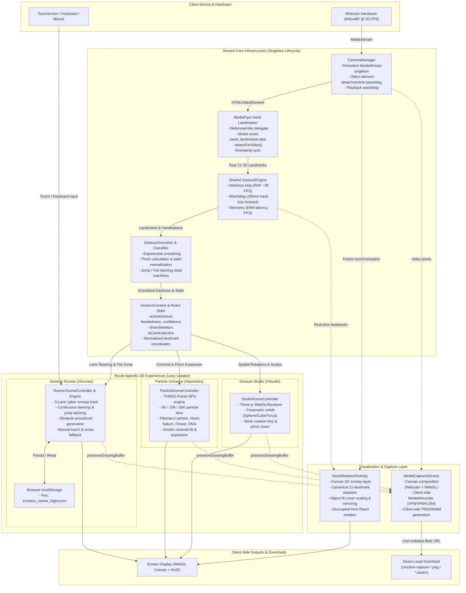

# System Architecture Diagram

This document contains the visual architectural topology of **ZMotion — Gesture Lab**.
It models the client-side data flows, computer vision pipeline, component lifecycles, and isolated execution domains.

> [!NOTE]
> ZMotion runs 100% in-browser. There are no backend databases, cloud storage buckets, or remote inference APIs.

## Shared vs. Route-Specific Architecture

| Component | Shared / Route-Specific | Description |
| :--- | :--- | :--- |
| `CameraManager` | **Shared Singleton** | Manages a single active `MediaStream` and `HTMLVideoElement` across all routes. Prevents hardware re-initialization and permission prompts. |
| `GestureEngine` | **Shared Singleton** | Coordinates MediaPipe vision inference loop, FPS tracking, and hand-loss timeout watchdog. |
| `GestureContext` | **Shared State** | Exposes reactive gesture tokens (`OPEN_PALM`, `PINCH`, `FIST`, `POINTING`) and hand tracking status. |
| `HandSkeletonOverlay` | **Shared Layer** | Transparent 2D canvas overlay hooked directly to `GestureEngine.onFrame` with zero React re-renders. |
| `MediaCaptureService` | **Shared Service** | In-memory frame compositor and `MediaRecorder` pipeline. Produces local client blobs. |
| `StudioSceneController` | **Route-Specific** | Three.js scene containing parametric 3D meshes, directional lights, and orientation smoothing. |
| `ParticleSceneController` | **Route-Specific** | GPU particle simulation with 5 shape manifolds, morphing interpolations, and expansion kinetics. |
| `RunnerSceneController` | **Route-Specific** | Game loop, lane physics, obstacle spawn system, collision detection, and score tracking. |
